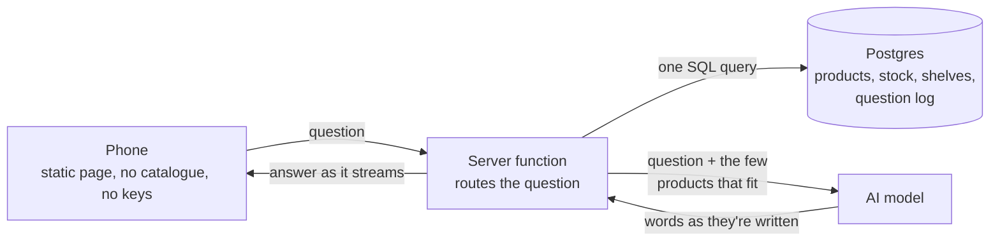

# Architecture

A shopper scans a QR code in store, asks by voice or text, and gets the aisle, bay, stock and a map. This document says how it works, how fast it has been measured, and what changes to run it for real.

Nothing here is a mock-up of the architecture. The page, server, database and AI are the real path a question takes. The data is the only thing that's stand-in, and it sits behind tables that real feeds would fill.

## How a question is answered

1. **The page holds nothing.** It sends the question, plus a short memory of the last answer so follow-ups like "got anything cheaper?" work. The server keeps nothing per shopper, so any server instance can answer any question.
2. **The server decides who answers.** The AI answers by default. The database answers directly only where there's one right answer and the AI can't beat it: an exact product word ("tent pegs"), a ranking ("cheapest fishing rod", "best tent under $200"), a store fact, a shopping list or a starter kit.
3. **Rankings are computed, never guessed.** "Cheapest" is an SQL sort over every product in stock at that store, not a model's opinion.
4. **The AI only sees what's on the shelf.** Search picks at most 18 products, with live price, aisle, bay and stock, and the AI recommends from those. It can't quote a product or price the store doesn't have. If search can't tell which shelf a question is about, the AI first says what to search for, then answers from the results.
5. **Voice mistakes are handled in two steps.** A misheard phrase is corrected directly only when the result is something the store really calls a product ("tint pegs" to "tent pegs"). Anything less certain goes to the AI as heard, so "snow chains" doesn't turn into "snow chinos".
6. **Every question is logged**, with no personal details, for the store's report: what people ask, what couldn't be answered, and when.

## Measured

From a home connection in Brisbane to the server in Sydney, on the free hosting plan, with the full 11,898 product catalogue. A phone on 4G adds its own network time. Re-run with `node scripts/latency.mjs`.

<!-- latency:start -->
| Kind of question | Answered by | Asked | First words, median | First words, 95th | Finished, median | Slowest | Failed |
|---|---|---|---|---|---|---|---|
| Store fact | fact | 6 | 0.05 s | 1.74 s | 0.05 s | 1.74 s | 0 |
| Exact product word | exact | 16 | 0.10 s | 0.32 s | 0.10 s | 0.32 s | 0 |
| Ranking over the whole catalogue | exact | 12 | 0.11 s | 0.15 s | 0.11 s | 0.15 s | 0 |
| Several things at once | list | 6 | 0.24 s | 0.33 s | 0.24 s | 0.33 s | 0 |
| Starter kit | kit | 4 | 0.28 s | 0.33 s | 0.28 s | 0.33 s | 0 |
| AI, knows the shelf | ai | 16 | 1.00 s | 1.31 s | 1.33 s | 1.82 s | 0 |
| AI, plans its own search first | ai | 8 | 1.23 s | 2.44 s | 1.59 s | 3.01 s | 0 |

Several shoppers at the same moment, everything except the AI call:

| At once | Median | 95th | Slowest | Failed |
|---|---|---|---|---|
| 5 | 0.26 s | 0.27 s | 0.27 s | 0 |
| 10 | 0.33 s | 0.50 s | 0.50 s | 0 |
| 25 | 0.71 s | 1.25 s | 1.30 s | 0 |
| 50 | 1.04 s | 2.11 s | 2.19 s | 0 |

8 real AI questions at once: first words median 1.58 s, slowest first words 1.91 s, slowest finished 2.25 s, 0 failed.
<!-- latency:end -->

Answers are checked by `node scripts/test_answers.mjs`: over 430 checks against the deployed server, with the expected results worked out from the raw data independently of the server's logic.

## What's real, what's stand-in, what changes

| Part | Today | For a real rollout | Size of the change |
|---|---|---|---|
| Products, prices, ratings | Real, from public category pages | Product feed | Fill the same tables |
| Aisle and bay | Sample | Planogram or location data | Fill the same column. **This data has to exist, and it's the first thing to check** |
| Stock | Sample, changes every 5 minutes to prove the path | Inventory feed, per store | Fill the same column |
| Store layouts | Sample map | One real layout per store | Data, plus a map per store |
| Stores | 3, selected by the QR link | All of them | New rows |
| AI model | DeepSeek, picked for speed and cost | A model hosted in Australia that meets the retailer's data rules | One function |
| Server and database | Supabase free plan, Sydney | Paid plan, or the same Postgres and server code in the retailer's cloud | Hosting, not code |
| Web page | GitHub Pages | The retailer's domain | Same files |
| Report access | One shared password | Staff sign-in | Small |
| Abuse limits | Per-device-address rate limit, daily AI cap | Same, tuned on real traffic | Settings |

## Known limits

- **Free hosting** pauses after a week without use, and gets slower past roughly 25 questions in the same instant. Its gateway also turned requests away for about a second once, during a burst of 50 at the same moment. The page retries on its own, so a shopper would just wait a second longer. Fine for one store; a chain needs the paid plan.
- **Voice** uses the speech recognition built into the phone's browser. It varies by device and is worse in a noisy store. Typing always works.
- **AI wording** can still oversell a product a little. It's limited to the products it's given, and it's told not to claim features the product name doesn't show, but this is a rule, not a guarantee.
- **The sample report** on `report.html` is generated data, and says so on the page. Its "Just asked" list and speed figure come only from real questions.

## Where things are

| Path | What it is |
|---|---|
| `index.html`, `app.js`, `style.css`, `config.js` | The shopper's page |
| `report.html`, `report.js`, `report.css` | The store's report |
| `supabase/functions/api/index.ts` | The endpoint: rate limits, AI streaming, logging |
| `supabase/functions/api/engine.mjs` | Routing, search, voice correction, what the AI gets told |
| `supabase/functions/api/text.mjs` | Shared word rules, also used when loading data |
| `supabase/migrations/` | Tables, search functions, report, scheduled jobs |
| `scripts/seed.mjs` | Loads the catalogue, stock and search words |
| `scripts/test_answers.mjs`, `scripts/latency.mjs` | Answer checks and latency measurement |
| `print/make_qr.py` | The store sign and a QR label per aisle |
